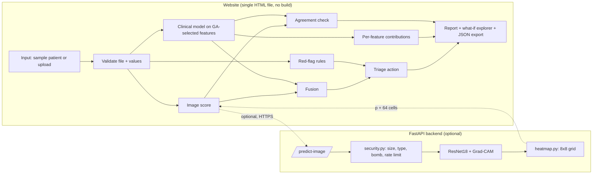

# Architecture

## Design decisions
| Decision | Why |
|---|---|
| Clinical model runs in the browser | Patient values never leave the device. Works offline and needs no server |
| Backend is optional | The demo works on a static host. Real Grad-CAM needs PyTorch, which Vercel cannot run |
| Logistic regression for the clinical model | Linear, so SHAP values are exact and easy to check (`tests/test_clinical_pipeline.py`) |
| GA for feature selection | Fewer inputs means less data entry. 8 of 18 features reach AUC 0.961 against 0.967 for all 18 |
| Red flags sit **outside** the model | A safety rule must not depend on a learned score. It fires even when the AI says "low risk" |
| Agreement check | When the X-ray and the clinical data disagree the fused number is least trustworthy, so say so |
| Pure logic kept separate from DOM code | The rules can be unit-tested in Node. `heatmap.py` and `security.py` avoid heavy imports so they test without PyTorch |
| Requests handled one at a time | Grad-CAM hooks the shared model. Scale with more workers instead of threads |

## Files
| Path | Role |
|---|---|
| `frontend/index.html` | Website: models, GA, explanations, what-if, accessibility |
| `backend/app.py` | API routes, CORS, rate limit, headers |
| `backend/security.py` | Upload validation, `RateLimiter`, origin parsing |
| `backend/model.py`, `heatmap.py` | ResNet18 + Grad-CAM, grid pooling |
| `backend/train.py` | Trains the image model, writes `model.pt` and `metrics.json` |
| `research/clinical_pipeline.py` | GA + clinical model + validation protocol |
| `research/medfusion_evo.py`, Colab notebook | Full multimodal pipeline with SHAP and a report figure |
| `tests/` | Python (`unittest`/pytest) and JavaScript (`node --test`) suites |
